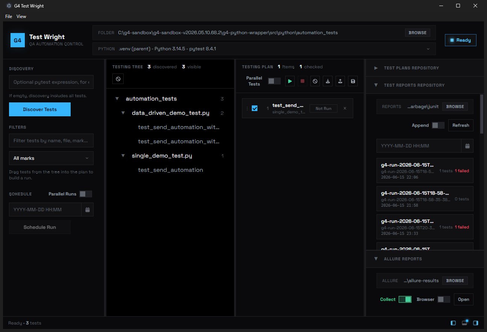
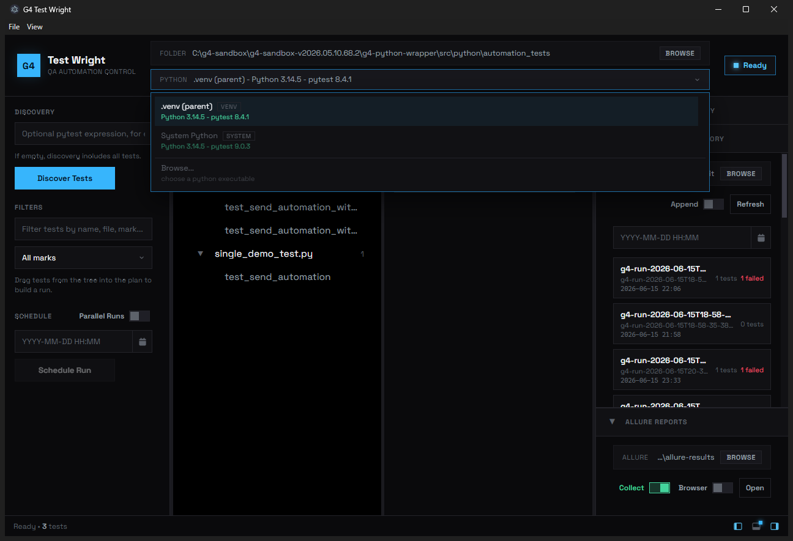

# G4 Test Wright

> A desktop **pytest test workbench** — discover, organize, run, schedule, and review Python tests from a fast, drag‑and‑drop UI.

G4 Test Wright is a cross‑platform [Electron](https://www.electronjs.org/) application that wraps your
existing `pytest` test suite in a visual control center. Point it at a tests folder, pick a Python
interpreter, discover tests into a navigable tree, drag the ones you care about into a run **Plan**,
and execute them with live per‑test status — with JUnit reports, [Allure](https://allurereport.org/)
integration, and timed scheduling built in.



---

## Table of Contents

- [Features](#features)
- [Screenshots](#screenshots)
- [Quick Start](#quick-start)
  - [Prerequisites](#prerequisites)
  - [Install & run](#install--run)
  - [First run in 60 seconds](#first-run-in-60-seconds)
- [Usage Guide](#usage-guide)
- [Configuration](#configuration)
- [Building & Packaging](#building--packaging)
- [Continuous Delivery](#continuous-delivery)
- [Architecture](#architecture)
- [Project Structure](#project-structure)
- [Troubleshooting](#troubleshooting)
- [Contributing](#contributing)
- [License](#license)

---

## Features

- **Folder‑based discovery** — select any folder; tests are collected via `pytest --collect-only`
  (bundled collector) and shown as a file‑path **Testing Tree**.
- **Smart interpreter picker** — auto‑discovers `venv`, `conda`, `poetry`, `pipenv`, and the system
  Python (nearest‑first), shows each one's Python + `pytest` version, and lets you **Browse…** for a
  custom executable. An explicit `G4_PYTHON` override is honored.
- **Filtering** — live text filter (name/file/mark) and a searchable, multi‑select **mark filter**.
- **Drag‑and‑drop run plan** — drag tests (or whole tree nodes) into the **Testing Plan**, reorder
  them, check/uncheck, and run top‑to‑bottom. The plan is self‑contained (survives re‑discovery).
- **Live runs** — per‑test status badges stream in as the run progresses; **Stop** cancels in‑flight
  runs. Optional **parallel** execution via `pytest-xdist` (`-n auto`).
- **JUnit reports** — every run writes a JUnit XML report; the **Test Reports Repository** scans a
  folder, lists results (pass/fail/skip counts), filters by date/time, opens a built‑in viewer, and
  lets you **drag a report back onto the plan** to rerun its tests.
- **Allure integration** — optionally collect Allure results (`--alluredir`) and open the report
  in‑app or in your browser (requires Java + `allure-pytest`).
- **Plan repository** — save/load portable `*.json` run plans to a folder; drag‑and‑drop to load
  (append or replace).
- **Scheduling** — queue up to 5 timed runs; choose whether due runs start in **parallel** or queue.
- **Workspace that remembers** — panel sizes, the console drawer, selected folders, filters, and the
  current plan are persisted and restored on the next launch.
- **Resizable, collapsible layout** — sidebar, repository column, and a bottom **console** drawer,
  each draggable and collapsible with edge handles.

## Screenshots

| Overview                                  | Interpreter picker                                        |
|-------------------------------------------|-----------------------------------------------------------|
|  |  |

The interpreter dropdown shows every discovered environment with its Python and `pytest` versions, and
a **Browse…** action for a custom interpreter.

## Quick Start

### Prerequisites

| Requirement                             | Why                            | Notes                                        |
|-----------------------------------------|--------------------------------|----------------------------------------------|
| **Node.js 18+** (20 LTS recommended)    | Runs the app + tooling         | bundles Electron 39 via `npm install`        |
| **Python 3** with **`pytest`**          | Test discovery & execution     | the app probes each interpreter for `pytest` |
| `pytest-xdist` *(optional)*             | Parallel test runs (`-n auto`) | enables the **Parallel Tests** toggle        |
| `allure-pytest` + **Java** *(optional)* | Collect & view Allure reports  | Java must be on `PATH` for the Allure viewer |

### Install & run

```bash
git clone https://github.com/g4-api/g4-test-wright.git
cd g4-test-wright
npm install
npm start
```

### First run in 60 seconds

1. **Browse** to a folder containing `pytest` tests (top **FOLDER** bar).
2. Confirm the **PYTHON** interpreter (auto‑selected; click to choose another or **Browse…**).
3. Click **Discover Tests** — the Testing Tree fills in.
4. Drag tests (or a tree node) into the **Testing Plan**.
5. Press **▶ Run**. Watch status badges update live; open the **Console** drawer for raw output.

## Usage Guide

- **Discovery** — optionally enter a pytest `-k` expression to narrow collection; leave empty to
  include all tests. Use the **Filters** box and **mark filter** to focus the tree.
- **Building a plan** — drag a single test or a whole tree node onto the plan; reorder by dragging
  rows; untick items you want to keep but skip. Save it via **File ▸ Save Plan…** or to the
  **Test Plans Repository**.
- **Running** — **▶** runs the checked items; **■** stops; the **Parallel Tests** toggle runs the
  plan's tests concurrently (needs `pytest-xdist`).
- **Reports** — point the **Test Reports Repository** at a folder of JUnit XML (runs auto‑write into
  a `.reports` folder under the rootdir). Click a report to view it, filter by date, or drag it onto
  the plan to rerun exactly those tests.
- **Allure** — toggle **Collect** to pass `--alluredir`, then **Open** the report (in‑app window or
  external **Browser**).
- **Scheduling** — pick a date/time and **Schedule Run**; the **Parallel Runs** toggle controls
  whether multiple due runs overlap or queue.

## Configuration

- **`G4_PYTHON`** — environment variable that forces a specific Python interpreter for discovery/runs,
  overriding auto‑detection.
- **`PYTHONDONTWRITEBYTECODE` / `PYTHONUNBUFFERED`** are set automatically for child pytest processes.
- Reports default to a hidden `.reports/` folder, Allure results to `.allure-results/`, and saved
  plans to `.repositories/` under the test rootdir unless you select explicit folders.

## Building & Packaging

The app packages with [electron-builder](https://www.electron.build/) (config lives in the `build`
field of `package.json`).

```bash
npm run dist        # build portable archives for the current OS into dist/
npm run dist:dir    # quick unpacked build (no archive) for local sanity checks
```

Targets are **portable archives** for all three desktop platforms, each for **x64 and arm64**:

| OS      | Format    | Arches     |
|---------|-----------|------------|
| Windows | `.zip`    | x64, arm64 |
| macOS   | `.zip`    | x64, arm64 |
| Linux   | `.tar.gz` | x64, arm64 |

The bundled `allure-commandline` is copied alongside the app via `extraResources` (resolved at runtime
from `resources/allure-commandline`).

## Continuous Delivery

`.github/workflows/release-pipeline.yml` builds **all 6 binaries** (3 OS × x64/arm64) on a matrix of
GitHub‑hosted runners.

- **Trigger** — push to `main` (changes to `README.md` alone are ignored), or run manually via
  *workflow_dispatch*.
- **Versioning** — a fresh, date‑based version is computed each run:
  `buildVersion = <yyyy.M>.<run_number>` (e.g. `2025.6.42`), validated against `^\d+(\.\d+){2}$` and
  stamped into `package.json`.
- **Release** — pushes to `main` publish a GitHub Release tagged **`v<buildVersion>`** named
  **`Production v<buildVersion>`** with all six archives attached. Manual runs upload the binaries as
  workflow artifacts only.
- **Signing** — builds are currently unsigned; secret hooks for macOS notarization and Windows code
  signing are present (commented) and ready to enable.

## Architecture

Electron split into a privileged **main** process, a sandboxed **renderer**, and a thin **preload**
bridge; the renderer is further organized into feature modules and reusable components.

| Layer          | Files                                       | Responsibility                                                                                                                           |
|----------------|---------------------------------------------|------------------------------------------------------------------------------------------------------------------------------------------|
| **Main**       | `src/js/main.js`                            | Window + native menu, IPC handlers, file dialogs, state/plan/report persistence                                                          |
|                | `src/js/pytest-backend.js`                  | The only place that talks to `pytest` + Python environments (discover, run, interpreters)                                                |
|                | `src/js/allure-backend.js`                  | Runs the bundled Allure CLI (serve / in‑app window)                                                                                      |
| **Bridge**     | `src/js/preload.js`                         | `contextBridge` exposes `pytestBackend`, `allureBackend`, and `g4` to the renderer (contextIsolation on, no nodeIntegration)             |
| **Renderer**   | `src/js/renderer.js`                        | Orchestrator + machine state (`state`/`runtime`, `showApp`, run manager, boot)                                                           |
|                | `src/js/renderer-*.js`                      | Console, dialogs, interpreters, marks, tree, plan, plan‑files, reports, allure, accordion, schedule, runner, layout, persistence, utils  |
| **Components** | `src/components/<name>/`                    | Vanilla components: date‑picker, modal, dropdown, interpreter‑picker, mark‑filter, toggle‑switch, empty‑state, console‑drawer, accordion |
| **Python**     | `src/py/collect_pytest.py`, `run_pytest.py` | Collector (prints fenced JSON) and streaming runner (emits fenced per‑test events)                                                       |

The renderer never reads Node/Electron directly — it goes through `window.pytestBackend` /
`window.allureBackend` / `window.g4`, which forward over IPC to the main process.

## Project Structure

```text
g4-test-wright/
├─ src/
│  ├─ index.html                 # app shell
│  ├─ css/                       # styles.css + styles.{parameters,layout,visual}.css
│  ├─ js/
│  │  ├─ main.js  preload.js     # main process + bridge
│  │  ├─ pytest-backend.js
│  │  ├─ allure-backend.js
│  │  ├─ pytest-client.js
│  │  ├─ renderer.js             # orchestrator + state
│  │  └─ renderer-*.js           # feature modules
│  ├─ components/<name>/         # name.js + name.{parameters,layout,visual}.css + name.css
│  └─ py/
│     ├─ collect_pytest.py
│     └─ run_pytest.py
├─ .github/workflows/release-pipeline.yml
├─ scripts/                      # legacy local packaging helpers
├─ docs/images/                  # README screenshots
└─ package.json
```

Each component follows the same convention: a `name.js` factory (`window.newX(...)`, pure DOM, no app
globals) plus a `name.css` entry that imports `name.parameters.css`, `name.layout.css`, and
`name.visual.css`.

## Troubleshooting

- **"Python 3 was not found"** — install Python 3 with `pytest`, or set `G4_PYTHON` to your
  interpreter path.
- **Interpreter shows "no pytest"** — `pytest` isn't installed in that environment; pick another or
  install it (`pip install pytest`).
- **Parallel toggle does nothing** — install `pytest-xdist` in the selected interpreter.
- **Allure won't open** — ensure **Java** is on `PATH` and `allure-pytest` is installed; check the
  Console drawer for details.
- **Discovery produced no output** — confirm the folder actually contains pytest‑importable tests and
  that imports succeed (a non‑zero pytest exit from import errors is tolerated, but no tests means no
  tree).
- **Unsigned‑build warnings** — macOS Gatekeeper / Windows SmartScreen will warn on unsigned builds;
  this is expected until signing secrets are configured in CI.

## Contributing

The codebase follows reusable coding standards captured as repo skills (`.claude/skills/`):
`js-ts-vanilla-style` (vanilla JS), `css-architecture` (3‑file component CSS), and `html-authoring`
(`data-test-id` coverage, attribute order). New components live under `src/components/<name>/` using
the JS + 3‑CSS convention above.

## License

[Apache‑2.0](LICENSE) © G4 Community
